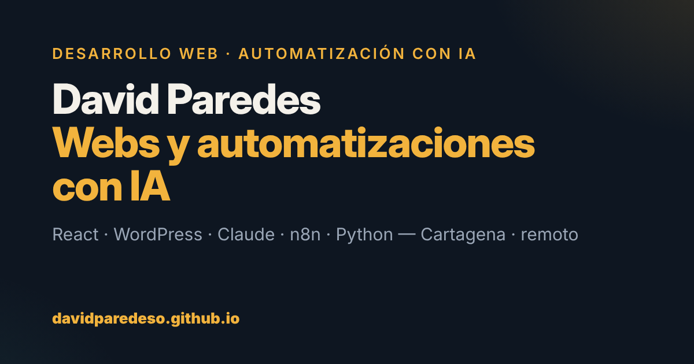
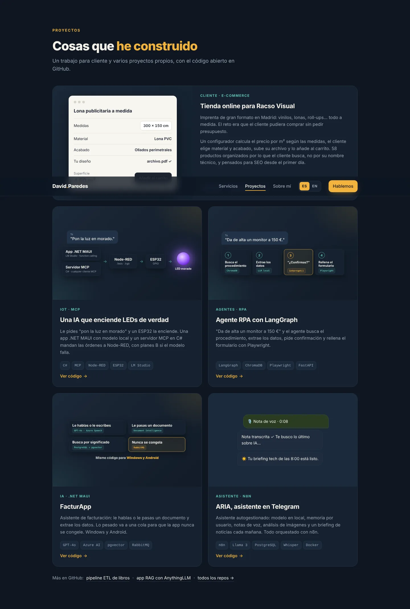
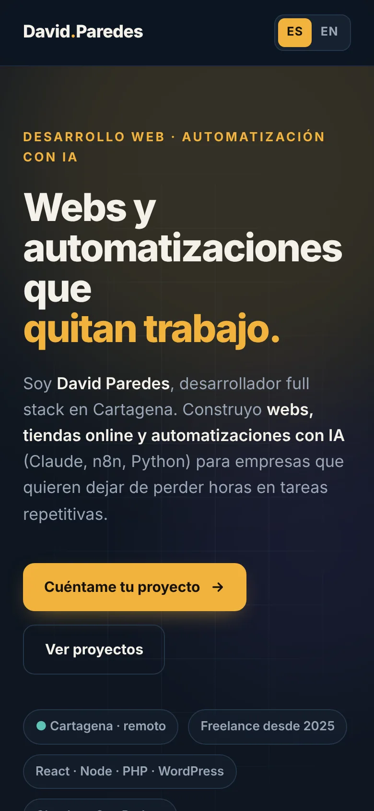
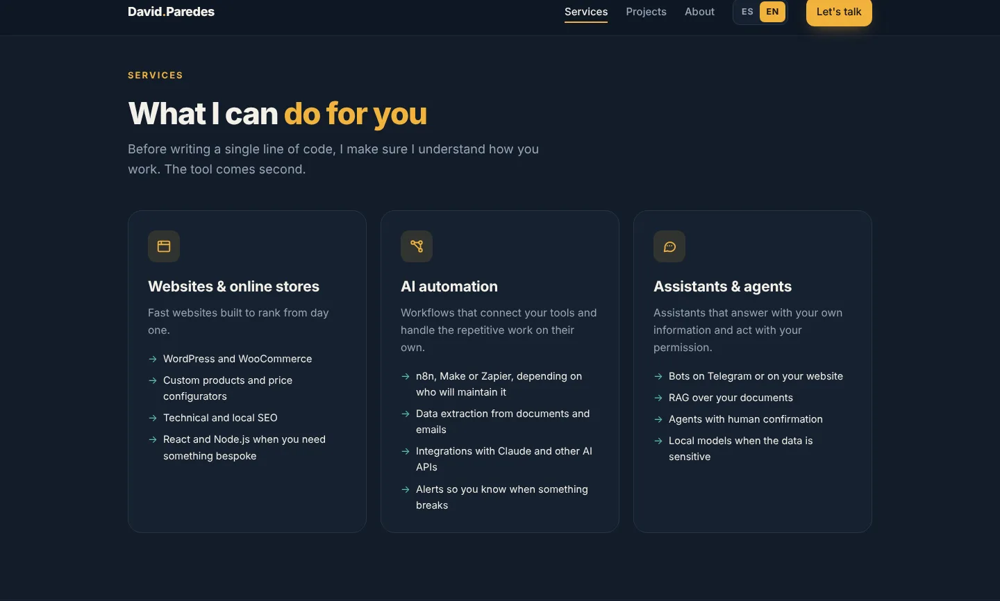
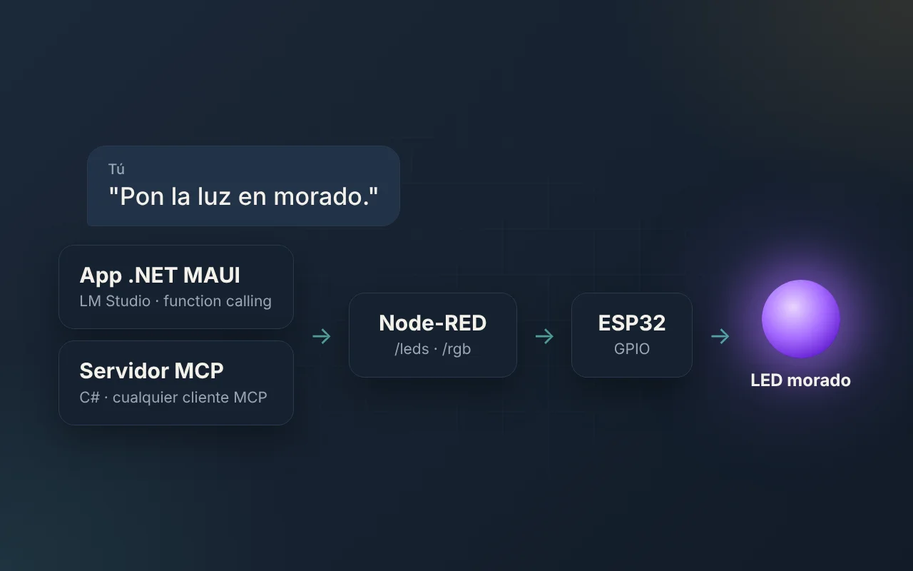

<div align="center">

<a href="https://davidparedeso.github.io">
  
</a>

<h1>davidparedeso.github.io</h1>

<p><strong>Portfolio de David Paredes</strong> — desarrollador web full stack y automatizaciones con IA.<br>
Webs, tiendas online y automatizaciones (Claude, n8n, Python) para empresas que quieren dejar de perder horas en tareas repetitivas.</p>

<p>
  <a href="https://davidparedeso.github.io"></a>
  <a href="https://github.com/davidParedesO/davidParedesO.github.io/actions/workflows/pages/pages-build-deployment"></a>
  <a href="LICENSE"></a>
</p>

<p>
  
  
  
  
  
  
</p>

<p>
  <a href="https://davidparedeso.github.io"><b>Ver la web</b></a> ·
  <a href="https://www.linkedin.com/in/david-paredes-dev">LinkedIn</a> ·
  <a href="#-english">English</a>
</p>

</div>

---

## 🖼️ Vista previa

<table>
  <tr>
    <td width="72%"></td>
    <td width="28%"></td>
  </tr>
  <tr>
    <td colspan="2"></td>
  </tr>
</table>

## ✨ Características

| | |
| --- | --- |
| 🌍 **Bilingüe ES / EN** | Cambio de idioma al instante, sin recargar. Detecta el idioma del navegador, lo recuerda y se puede compartir con `?lang=en`. Traduce también el título, la descripción, los textos alternativos y las imágenes. |
| 🎬 **Animaciones** | Titular que se escribe solo, entrada palabra a palabra, fondos animados, marquesina de tecnologías, apariciones al hacer scroll, foco de luz que sigue al cursor, inclinación 3D en los proyectos, botones magnéticos, línea de tiempo que se rellena y barra de progreso de lectura. |
| ♿ **Accesible** | HTML semántico, enlace para saltar al contenido, foco visible, textos alternativos y `aria-*`. Si el sistema pide menos movimiento (`prefers-reduced-motion`), se desactivan todas las animaciones. |
| 🔎 **SEO** | Metadatos Open Graph y Twitter, datos estructurados `schema.org/Person`, `hreflang`, `sitemap.xml`, `robots.txt` y URL canónica. |
| ⚡ **Ligera** | Sin frameworks ni dependencias: unos 17 KB comprimidos entre HTML, CSS y JS. Imágenes en WebP con carga diferida. |
| 📱 **Responsive** | Diseñada para móvil, tablet y escritorio, sin scroll horizontal. Los efectos de ratón solo se activan con puntero fino. |

## 🧱 Stack

- **HTML5 + CSS3 + JavaScript** puro, sin frameworks ni proceso de build.
- Tipografía [Inter](https://rsms.me/inter/) desde Google Fonts.
- Alojamiento en **GitHub Pages** (`.nojekyll`: se sirve tal cual, sin Jekyll).

## 📁 Estructura

```text
.
├── index.html          # Página principal (el contenido en español vive aquí)
├── 404.html            # Página de error personalizada
├── css/
│   └── styles.css      # Tokens, componentes, animaciones y responsive
├── js/
│   ├── i18n.js         # Traducciones al inglés
│   └── main.js         # Idioma, animaciones e interacciones
├── assets/img/         # Miniaturas de proyectos (ES/EN) e imagen para redes
├── docs/               # Capturas para este README
├── favicon.svg
├── site.webmanifest
├── robots.txt
├── sitemap.xml
└── .nojekyll
```

## 🚀 Ejecutar en local

No hace falta instalar nada. Desde la carpeta del repo:

```bash
# Con Python
python -m http.server 8000

# o con Node
npx serve .
```

Y abre <http://localhost:8000>.

## 🌍 Traducciones

El español está directamente en `index.html`, y el inglés en `js/i18n.js`, con la misma clave:

```html
<!-- index.html -->
<h3 data-i18n="svc.1.t">Webs y tiendas online</h3>

```

```js
// js/i18n.js
"svc.1.t": "Websites & online stores",
"p2.img": "assets/img/iot-en.webp",
```

Para añadir un idioma nuevo, crea otro bloque en `window.I18N` (por ejemplo `fr`) y un botón `data-lang="fr"` en el selector.

## ➕ Añadir un proyecto

Copia una tarjeta `.proj` dentro de `#proyectos` en `index.html`, pon sus textos con `data-i18n` y añade las claves en inglés en `js/i18n.js`. Las miniaturas son de 1280×800 en WebP, con versión `-es` y `-en`.

## 📦 Despliegue

Cada `push` a `main` se publica automáticamente con GitHub Pages en <https://davidparedeso.github.io>.

## 🗺️ Próximos pasos

- [ ] Dominio propio
- [ ] Formulario de contacto
- [ ] Casos de estudio con más detalle por proyecto
- [ ] Modo claro

---

## 🇬🇧 English

Personal portfolio of **David Paredes**, a full-stack web developer specialising in **AI automation** (Claude, n8n, Python), based in Cartagena, Spain.

- **Live site:** <https://davidparedeso.github.io> (English version: [`?lang=en`](https://davidparedeso.github.io/?lang=en))
- **Features:** bilingual ES/EN without reloading, scroll and pointer animations (fully disabled with `prefers-reduced-motion`), semantic and accessible HTML, SEO metadata with `hreflang` and structured data, and zero dependencies (~17 KB gzipped).
- **Run locally:** `python -m http.server 8000`, then open `http://localhost:8000`.

## 📬 Contacto

¿Tienes una tarea repetitiva que te gustaría quitarte de encima? Escríbeme por [LinkedIn](https://www.linkedin.com/in/david-paredes-dev).

## 📄 Licencia

El **código** (HTML, CSS y JS) está bajo licencia [MIT](LICENSE): úsalo como base para tu propio portfolio.
El **contenido personal** (textos, descripciones de proyectos, imágenes y datos) es © David Paredes Ortuño.
